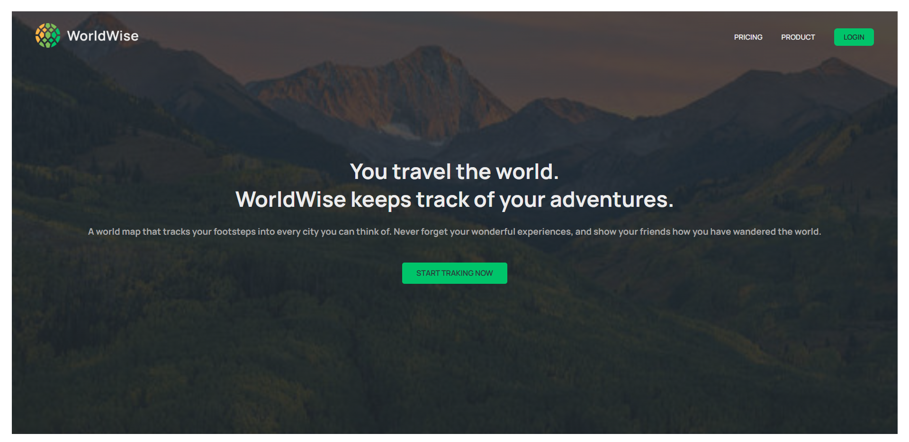

# WorldWise 🌍

A React app for keeping track of the cities you've visited, using an interactive world map.

> This project was built while following **"The Ultimate React Course"** by Jonas Schmedtmann on Udemy. It is not an original idea and was not built from scratch: I started from the [starter files provided in the course](https://github.com/jonasschmedtmann/ultimate-react-course/tree/5c38ad0e9f5067d4a486e8ee5d7bed36268fbbb8/11-worldwise/starter) (styles and some base components) and implemented the app logic step by step to practice React.

## Features

- Interactive map (Leaflet) showing all your visited cities as markers
- Click anywhere on the map to add a new city; the city and country are detected automatically (reverse geocoding)
- Add the date of the trip and personal notes
- List of visited cities and a list of countries
- City details page with a link to Wikipedia
- Delete cities from your list
- Use your current location to center the map (Geolocation API)
- Fake login with protected routes

## What I practiced

- React Router: nested routes, URL params and query strings (`useParams`, `useSearchParams`)
- Global state with Context API + `useReducer`
- Custom hooks (`useGeolocation`, `useUrlPosition`)
- Fetching data from a fake REST API (`json-server`) with loading and error states
- Code splitting with `React.lazy` and `Suspense`

## Tech

React, React Router, Leaflet / React Leaflet, React Datepicker, json-server, Vite, CSS Modules

## Getting started

1. Install the dependencies: npm install
2. Start the fake API (runs on port 9000): npm run server
3. In a second terminal, start the app: npm run dev

The fake API and the app must run at the same time.

### Demo login

- Email: `jack@example.com`
- Password: `qwerty`

Authentication is only for demo purposes: it is not persisted, so refreshing the page logs you out.

## Secreenshots

## Demo

